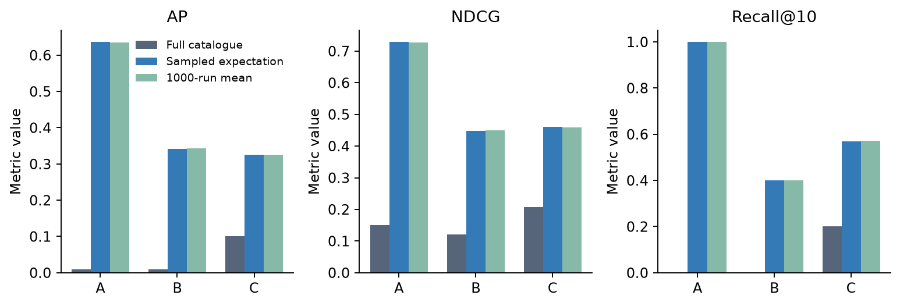
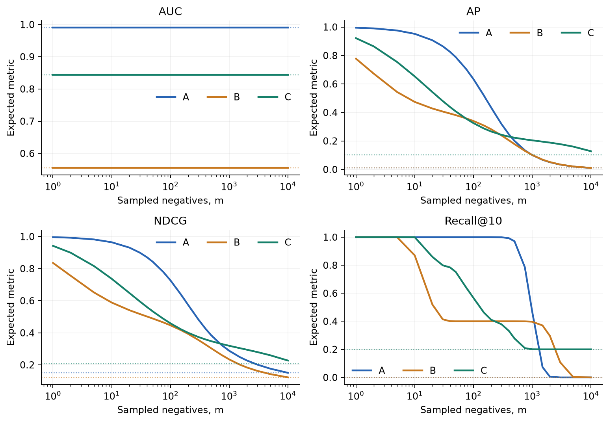
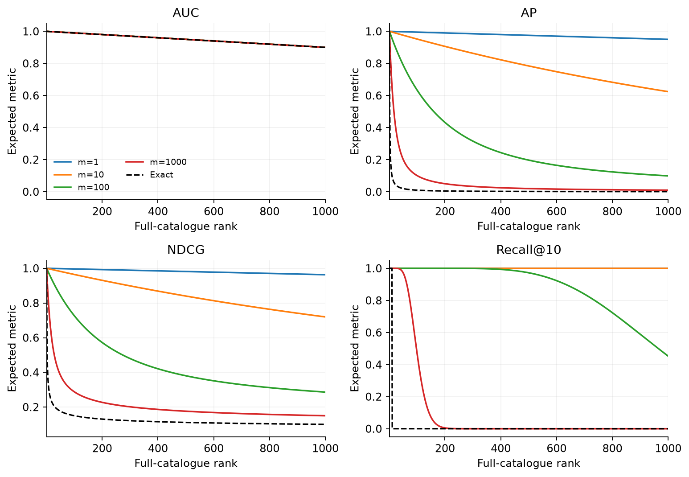

# [Re] Ranking reversals under sampled recommendation metrics

A scoped replication of the IJCAI 2021 illustrative experiment

Jill Vekariya. Independent researcher. Pre-submission draft.
Correspondence: jillvekariya.10@gmail.com

[Re] Ranking reversals under sampled recommendation metrics

A scoped replication of the IJCAI 2021 illustrative experiment

**Jill Vekariya**

Independent researcher | 12 November 2026 | Proposed venue: ReScience C

Correspondence: <link href="mailto:jillvekariya.10@gmail.com">jillvekariya.10@gmail.com</link>

## Abstract

An independent Python implementation is used to revisit the fixed-rank counterexample in Krichene and Rendle's IJCAI 2021 article. Finite-distribution expectations, 1000-repeat Monte Carlo evaluations and separate 100000-repeat checks reproduce the central ranking reversal. Full-catalogue average precision favors C over A (0.101379 versus 0.010000), whereas evaluating with 99 uniformly sampled negatives favors A over C (expected values 0.636592 versus 0.326169). Expected AUC is invariant to sample size. All 12 printed exact-metric values agree at the source's three-decimal precision. Secondary calculations retain the reversal without replacement and show remaining bias after a simple rank correction. The evidence concerns a designed five-instance example, not trained models or real users.

**Keywords:** recommender evaluation; sampled metrics; partial replication; Python

## 1. Objective and scope

The replication target is the numerical example in Tables 1 and 2 and the expectation curves in Figures 2 and 3 of the published IJCAI 2021 extended abstract [1]. Its narrow question is whether sampling irrelevant candidates can reverse a comparison between fixed recommender rankings, even after averaging out sampling noise. The source is a self-contained published result related to the authors' longer KDD 2020 paper [2].

Zhao et al.'s broader evaluation study [3] also examines how sampled candidates and evaluation settings affect comparisons between recommendation algorithms. The present target is narrower: the published fixed-rank counterexample isolates the metric calculation from model training and data splitting. It tests a specific numerical claim, rather than measuring the prevalence of ranking reversals across learned models or real-world datasets.

The contribution here is an independently executable verification package: exact expectations and macro-evaluation variances, random simulation, finite-catalogue correctness oracles, two operating systems and transparent comparison at unrounded precision. The fixture and the inconsistency claim are credited to the original authors; the phenomenon is not presented as a new discovery.

## 2. Frozen computational protocol

The catalogue contains n=10000 items and exactly one relevant item for each of five evaluation instances. A, B and C are the source's constructed rank lists, not learned model implementations. Rank 1 is best. These numerical inputs require no user records, dataset download or training.

| Recommender | Full-catalogue ranks of the five relevant items |
|---|---|
| A | 100, 100, 100, 100, 100 |
| B | 40, 40, 8437, 9266, 4482 |
| C | 212, 2, 743, 5342, 1548 |

For one relevant item, AP(r)=1/r, NDCG(r)=1/log2(r+1), Recall@10(r)=1[r≤10], and AUC(r)=(n-r)/(n-1). All reported scores are arithmetic means across the five instances. The untruncated AP and NDCG definitions follow the source.

The primary protocol samples m irrelevant items uniformly with replacement, excluding the relevant item. If K sampled entries outrank the relevant item, its sampled rank is 1+K. With p=(r-1)/(n-1), K follows Binomial(m,p). Repeated draws count as repeated entries under this protocol. A sampled AUC therefore uses a catalogue size of m+1 and a denominator of m, rather than n-1.

Expected metrics are obtained by summing M(1+k)Pr(K=k), for k=0,...,m. The variance of a single five-instance macro evaluation is the sum of the five instance variances divided by 25, with draws independent across instances. SD below denotes the square root of this variance. The Monte Carlo standard error of an average over R repeated evaluations is SD/√R; the two quantities are distinct.

The configuration was frozen before final metric evaluation (protocol v1.0). The primary sample size is 99 negatives. One thousand repetitions use NumPy seeds 20261112, 20261113 and 20261114 for A, B and C. Separate 100000-repeat checks use those seeds plus 10000. Twenty-three declared sample sizes from 1 to 9999 support the sensitivity curves; no outcome-dependent tuning is used.

## 3. Independent implementation and checks

The code was written from the published definitions. NumPy provides random draws and SciPy provides binomial and hypergeometric mass functions. Exhaustive enumeration of all small-catalogue sequences and subsets checks those distributions. Separate direct negative-item sampling checks metric means. Other tests cover rank boundaries, exclusion of the positive, repeated negative draws, complete sampling, aggregation, fixed seeds, invalid inputs and the closed-form binomial AP expectation.

For AP, the independent closed-form oracle is [1-(1-p)<super>m+1</super>]/[(m+1)p] for p&gt;0, with limiting value 1 at p=0. Expected AUC must equal full-catalogue AUC. When m=1, every metric has expectation (1-p)M(1)+pM(2); Recall@10 is then constant, rather than a useful AUC comparison.

## 4. Primary replicated results

Table 1 reports independent full-catalogue calculations. All entries round to the values printed in the original Table 1. In particular, C has higher AP and NDCG than A, whereas A has higher AUC.

| Model | AUC | AP | NDCG | Recall@10 |
|---|---|---|---|---|
| A | 0.990099 | 0.010000 | 0.150190 | 0.000000 |
| B | 0.554755 | 0.010090 | 0.121660 | 0.000000 |
| C | 0.843144 | 0.101379 | 0.208033 | 0.200000 |

**Table 1.** Independently calculated full-catalogue metrics. These are deterministic values.

With 99 sampled negatives, expected AP ranks A above B above C. Expected NDCG ranks A above C above B. Sampling reverses the A-versus-C comparison for both metrics, without requiring any particular random realization. The 1000-repeat AP estimates are 0.634902, 0.343412 and 0.325680 for A, B and C; the corresponding analytic expectations are shown in Table 2.

| Model | AP expectation ± SD | NDCG expectation ± SD | Recall@10 expectation |
|---|---|---|---|
| A | 0.636592 ± 0.130393 | 0.728989 ± 0.097758 | 1.000000 |
| B | 0.340739 ± 0.071091 | 0.447337 ± 0.052787 | 0.400000 |
| C | 0.326169 ± 0.050873 | 0.459986 ± 0.039519 | 0.569422 |

**Table 2.** Analytic moments of a single five-instance evaluation, m=99, with replacement. The SD is not the uncertainty of the analytic expectation.

Figure 1. Full-catalogue metrics, sampled expectations and 1000-repeat Monte Carlo means for the published rank fixture.

Across the declared uncorrected sample sizes and both sampling schemes, the largest absolute AUC expectation error is 1.23×10<super>-15</super> or less. Every calibration mean falls within five analytic Monte Carlo standard errors of its target (largest absolute standardized error below 1.2).

## 5. Sample-size sensitivity and secondary analyses

Figure 2. Recomputed expectation curves on the frozen sample-size grid. Dotted lines show each full-catalogue metric; line segments interpolate the evaluated points.

For AP, the computed orders are A&gt;C&gt;B at m=20, A&gt;B&gt;C at m=200, and C&gt;A&gt;B at m=500. These reproduce the source's illustrated changes. At m=9999, the order is C&gt;B&gt;A; full-catalogue B AP is 0.010089912 and A AP is 0.010000000. Their equality in the printed table is a three-decimal rounding effect. With-replacement sampling at m=n-1 does not exhaust the catalogue.

The prespecified without-replacement extension uses K~Hypergeometric(n-1,r-1,m). At m=99, expected AP is 0.635805, 0.340548 and 0.325970 for A, B and C, preserving the reversal. At m=9999, all four metrics for all three recommenders equal their exact full-catalogue values, as they must when every irrelevant item is included once.

The secondary Eq.9 correction evaluates the metric at floor[1+(n-1)K/m]. At m=99 with replacement, corrected AP is 0.378158, 0.272897 and 0.223821. This reduces AP's absolute bias for each fixture recommender, but still ranks A above C. This limited result concerns the simple rank correction, not the source's bias-variance estimators or its trained-model study.

## 6. Agreement, uncertainty and discrepancies

All primary directional checks pass. The source's Table 2 contains simulation estimates rather than exact expectations; its random seed is not specified in the selected article. For example, the source reports A's sampled AP as 0.630±0.129, compared with the independently calculated expectation 0.636592 and SD 0.130393. A repeated-evaluation mean need not match to three decimals.

No published Table 2 mean triggers the frozen diagnostic threshold: a 0.0005 rounding allowance plus 3.29 combined standard errors, conditional on the source's stated 1000 independent repetitions. This is a descriptive compatibility check, not proof of identical experimental code. The exact SDs, the new simulated SDs, source SDs and every mean difference are retained in CSV. No population p-value or user-bootstrap interval is appropriate for these five designed instances.

## 7. Execution and reproducibility

The primary implementation was executed through Desktop Commander on a Windows 11 laptop with 16 GB RAM and 12 logical processors, using Python 3.13.3, NumPy 2.5.4 and SciPy 1.18.1. All 40 tests passed before final evaluation. An earlier run stopped before metric evaluation because Windows path separators broke a provenance lookup. The path serialization was corrected, the failure log retained and the experiment rerun; the scientific protocol was unchanged.

Linux execution (Python 3.12.14, NumPy 2.3.5, SciPy 1.17.0) agreed to numerical precision. A fresh Windows virtual environment installed pinned dependencies, passed all 40 tests and repeated the experiment. Every primary summary and saved Monte Carlo array matched the first Windows run exactly. Source and protocol hashes, Git commits, seeds, software versions, timings and the detailed reproduction report accompany the package.

python -m pip install -r requirements.txt python -m pip install -r requirements-manuscript.txt python -m pytest -q python run_experiments.py --output results/new-run python build_manuscript.py

Run commands from the project root. A new output directory is required to preserve existing evidence. The manuscript builder uses the archived Windows result table and regenerates its numerical tables automatically; a comparison script audits rerun values against that evidence.

## 8. Limitations and conclusion

This is a partial replication of an intentionally designed counterexample. It provides no estimate of prevalence in deployed systems, no performance benchmark, no evidence about training quality, and no reproduction of corrected-metric success rates on real data. The five instances have independent candidate draws; shared candidate sets would require a different variance calculation. The literature and journal overlap searches are documented but do not prove novelty or editorial suitability.

Within this fixed and explicit scope, the independent calculations support the original result: sampling can change the question answered by a ranking metric and reverse a relative comparison in expectation. Repeating a biased sampled evaluation more often does not recover the intended full-catalogue metric. The preserved code and numerical oracles make that claim directly testable.

## Appendix. Metric-shape verification

Figure 3. Independent reconstruction of the source Figure 3 concept: expected sampled metrics against full-catalogue rank, shown through rank 1000 of n=10000. Values are evaluated on the frozen grid.

## Availability and declarations

Code and data availability: the accompanying private review package includes the independent implementation, the attributed numerical fixture, results, figures, tests and reproduction instructions. The intended code repository is https://github.com/Jill-Vekariya/sampled-metrics-replication; public release awaits author authorization. No third-party article PDF or real-user dataset is included in the release archive. The intended code license is MIT; the manuscript is intended for CC BY 4.0, subject to author approval.

ORCID status, competing-interest and funding declarations, contribution statement, and confirmation of journal eligibility remain for author verification. No declaration has been signed and no submission has occurred. AI assistance: ChatGPT generated and revised research code, performed tool-driven execution and audits, and drafted this manuscript. The described review passes are simulated AI assessments, not independent human peer review. An author must review and take responsibility for the final research and text.

## References

[1] W. Krichene and S. Rendle. On Sampled Metrics for Item Recommendation (Extended Abstract). Proceedings of IJCAI 2021, pp. 4784-4788. DOI: 10.24963/ijcai.2021/651. Primary replication target.

[2] W. Krichene and S. Rendle. On Sampled Metrics for Item Recommendation. Proceedings of KDD 2020, pp. 1748-1757. DOI: 10.1145/3394486.3403226. Related full publication; its real-data experiment is outside scope.

[3] W. X. Zhao, Z. Lin, Z. Feng, P. Wang and J.-R. Wen. A Revisiting Study of Appropriate Offline Evaluation for Top-N Recommendation Algorithms. ACM Transactions on Information Systems 41(2), article 32 (online 2022). DOI: 10.1145/3545796. Initial target assessed during feasibility selection.
